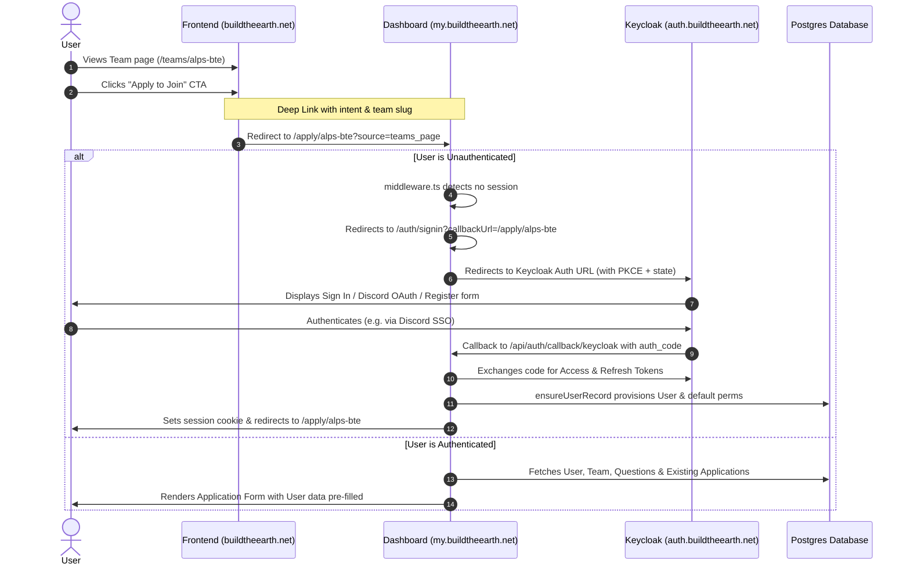
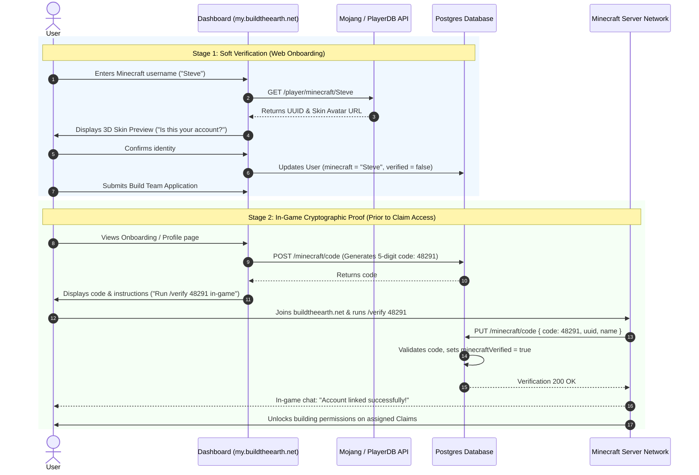
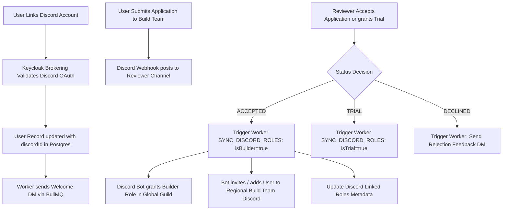

# Research: Onboarding, Welcoming, and Sign-Up System Architecture

**Target Platform**: BuildTheEarth Web Platform  
**Target File**: `docs/research/onboarding-welcoming-signup-system.md`  
**Date**: October 2026  
**Context**: Static frontend (`apps/frontend` on `buildtheearth.net`) housing public static marketing/information, and an interactive dashboard (`apps/dashboard` on `my.buildtheearth.net`) housing all user interaction, authentication, onboarding, applications, and claim management.

---

## 1. Executive Summary

The BuildTheEarth (BTE) web platform coordinates regional **Build Teams**, geospatial territory **Claims**, builder **Applications**, and community **Showcases** for the 1:1 recreation of planet Earth in Minecraft.

The web platform is architected around a strict decoupled separation of concerns:

1. **Static Frontend (`apps/frontend`)**: Serves statically generated (SSG/ISR) public pages on `buildtheearth.net`. It contains zero interactive session state, zero secrets, and zero direct database mutation capabilities, maximizing edge cacheability, SEO, and load performance.
2. **Interactive Dashboard (`apps/dashboard`)**: Serves authenticated and interactive experiences on `my.buildtheearth.net` (powered by Next.js, NextAuth.js v4, Mantine UI, and direct access to PostgreSQL via `@repo/db`).
3. **Backend Services (`apps/api`, `apps/api-v2`, `apps/worker`)**: Provide REST APIs, Keycloak admin synchronization, in-game verification validation, and asynchronous background tasks via Redis/BullMQ.

This research investigates the end-to-end **Sign-Up, Welcoming, and Onboarding system**, establishing:

- **Zero-friction handoff** between the static frontend and the interactive dashboard.
- **Progressive profiling** from unauthenticated visitor to authenticated **User**, linked **Member**, **Trial** builder, and full **Builder**.
- **Credentials verification** for both Discord (via Keycloak identity brokering and internal bot API) and Minecraft (via Mojang/PlayerDB skin resolution and in-game token redemption).
- **A step-by-step onboarding wizard** replacing the current static checklist.

---

## 2. Domain Vocabulary & Glossary Compliance

In accordance with [`GLOSSARY.md`](file:///T:/Dev/bte/web/GLOSSARY.md), all architectural designs, database references, and UX copy adhere strictly to the project's canonical vocabulary:

| Canonical Term        | Definition                                                                                                                                       | Prohibited Synonyms (Do Not Use)                |
| :-------------------- | :----------------------------------------------------------------------------------------------------------------------------------------------- | :---------------------------------------------- |
| **User**              | An authenticated account identified via single sign-on (SSO) with linked Discord and Minecraft credentials.                                      | _Account, player, visitor_                      |
| **Member**            | A user who belongs to a specific build team.                                                                                                     | _Team affiliate, participant_                   |
| **Builder**           | A user actively assigned to work on one or more claims or authorized by a build team to construct within its territories.                        | _Worker, architect, craftsman_                  |
| **Reviewer**          | A build team member authorized to inspect and accept or decline incoming builder applications.                                                   | _Evaluator, judge, moderator_                   |
| **Build Team**        | An autonomous regional organization responsible for coordinating builders and managing claims within a specific real-world geographic territory. | _Group, project, sub-team, region guild_        |
| **Claim**             | A designated geographic polygon on the real-world Earth map assigned to a builder or build team for recreation in Minecraft.                     | _Plot, region, zone, land, parcel_              |
| **Showcase**          | A curated highlight of a completed or notable build within a claim or build team, featured publicly with imagery.                                | _Portfolio item, gallery post, spotlight_       |
| **Upload**            | A stored binary media file (such as an in-game screenshot) associated with a showcase or claim.                                                  | _Attachment, screenshot, asset, picture_        |
| **Calendar Event**    | A scheduled public or team-specific building session, contest, or milestone event.                                                               | _Schedule entry, meetup, session, contest_      |
| **Application**       | A structured request submitted by a user to join a build team, consisting of responses to team-configured questions.                             | _Submission, audition, enrollment form, ticket_ |
| **Trial**             | A probationary evaluation state granted to an applicant who must demonstrate building competence before receiving full membership.               | _Audition, probation, test run_                 |
| **Response Template** | A reusable preset message used by reviewers when communicating application review outcomes to applicants.                                        | _Canned response, boilerplate, snippet_         |

---

## 3. Current Codebase Investigation & State Analysis

A comprehensive audit of the monorepo reveals the following baseline components:

### 3.1 Static Frontend (`apps/frontend`)

- **Framework & Rendering**: Built on Next.js 16 (`standalone` output) with `next-intl` internationalization. Pages like `/get-started` ([`page.tsx`](file:///T:/Dev/bte/web/apps/frontend/src/app/[locale]/get-started/page.tsx#L39)) and `/teams/[slug]` ([`page.tsx`](file:///T:/Dev/bte/web/apps/frontend/src/app/[locale]/teams/[slug]/page.tsx#L82)) enforce ISR caching via `export const revalidate = 3600` (1 hour).
- **Navigation & CTAs**:
  - The public header ([`components/layout/header/index.tsx`](file:///T:/Dev/bte/web/apps/frontend/src/components/layout/header/index.tsx#L58-L78)) features `/visit` and `/get-started`. It currently lacks a direct "Sign In" or "Dashboard" link.
  - The team profile page ([`apps/frontend/src/app/[locale]/teams/[slug]/page.tsx`](file:///T:/Dev/bte/web/apps/frontend/src/app/[locale]/teams/[slug]/page.tsx#L176-L184)) contains a hardcoded legacy link:
    ```tsx
    {
    	/* TODO: replace URL */
    }
    ;<LinkButton
    	href={`https://beta.buildtheearth.net/teams/${buildTeam.slug}/apply`}
    	w={{ base: '100%', md: 'auto' }}
    	maw="none"
    	mb={{ base: 'xl', md: 0 }}
    >
    	{t('apply')}
    </LinkButton>
    ```
    _(Note: This URL targets the old `beta.buildtheearth.net` instead of `my.buildtheearth.net/apply/${buildTeam.slug}`)_.
- **Dependencies**: Completely devoid of `@next-auth` or session handling (`apps/frontend/package.json#L16-L42`). It interacts with Directus CMS and reads from PostgreSQL via `@repo/db` during build time and ISR regeneration.

### 3.2 Dashboard (`apps/dashboard`)

- **Authentication Stack**: Uses NextAuth.js v4 configured with Keycloak OIDC provider ([`apps/dashboard/src/util/auth.ts`](file:///T:/Dev/bte/web/apps/dashboard/src/util/auth.ts#L103-L126)). Tokens refresh automatically using Keycloak's `/protocol/openid-connect/token` endpoint ([`util/auth.ts:44-101`](file:///T:/Dev/bte/web/apps/dashboard/src/util/auth.ts#L44-L101)).
- **Middleware & Protection**:
  - [`apps/dashboard/src/middleware.ts`](file:///T:/Dev/bte/web/apps/dashboard/src/middleware.ts#L3-L24) wraps all dashboard routes with NextAuth `withAuth`, excluding only `api`, static assets, `auth`, and `missing-role`.
  - Unauthenticated requests bounce to `/auth/signin` ([`apps/dashboard/src/app/auth/signin/page.tsx`](file:///T:/Dev/bte/web/apps/dashboard/src/app/auth/signin/page.tsx#L11-L22)), which immediately initiates Keycloak OAuth redirect.
  - Role and permission gating is enforced via the `<Protection>` component ([`apps/dashboard/src/components/Protection.tsx`](file:///T:/Dev/bte/web/apps/dashboard/src/components/Protection.tsx#L9-L51)).
- **User Provisioning**:
  - In `jwt` callback ([`util/auth.ts:154-185`](file:///T:/Dev/bte/web/apps/dashboard/src/util/auth.ts#L154-L185)), `ensureUserRecord` from [`util/ensureUser.ts`](file:///T:/Dev/bte/web/apps/dashboard/src/util/ensureUser.ts#L49-L224) checks if the user exists in PostgreSQL.
  - If new: creates the `User` record, queries Keycloak for linked federated identities (Discord ID), assigns default permissions (`account.info`, `account.edit`), and enqueues a welcome Discord DM job via Redis BullMQ ([`ensureUser.ts:209-221`](file:///T:/Dev/bte/web/apps/dashboard/src/util/ensureUser.ts#L209-L221)).
- **Current Welcoming Experience**:
  - [`apps/dashboard/src/app/(sideNavbar)/welcome/page.tsx`](<file:///T:/Dev/bte/web/apps/dashboard/src/app/(sideNavbar)/welcome/page.tsx#L27-L168>) provides a basic static checklist showing Discord connection status, a link to the global Discord server, and external links back to the frontend build team list and map. It lacks guided progression, role selection, or Minecraft account linking.
- **Application Flow**:
  - [`apps/dashboard/src/app/(sideNavbar)/apply/[slug]/page.tsx`](<file:///T:/Dev/bte/web/apps/dashboard/src/app/(sideNavbar)/apply/[slug]/page.tsx#L49-L300>) loads team-configured questions from `ApplicationQuestion` and handles submission via Server Action `applyToBuildTeam`.

### 3.3 Backend APIs & Workers (`apps/api`, `apps/api-v2`, `apps/worker`)

- **`apps/api`**:
  - Express server. Contains [`CheckNewUserMiddleware.ts`](file:///T:/Dev/bte/web/apps/api/src/web/routes/utils/CheckNewUserMiddleware.ts#L4-L180), which synchronizes Keycloak user attributes (`minecraft`, `minecraftVerified`, `discordId`) to the database on API calls.
  - [`UserController.ts:327-421`](file:///T:/Dev/bte/web/apps/api/src/controllers/UserController.ts#L327-L421) defines Minecraft verification code generation (`POST /minecraft/code`) and redemption (`PUT /minecraft/code`).
  - [`DiscordIntegration.ts:60-99`](file:///T:/Dev/bte/web/apps/api/src/util/DiscordIntegration.ts#L60-L99) integrates with an internal Discord Bot API to check guild membership and update builder roles.
- **`apps/api-v2`**:
  - NestJS modular backend currently dedicated to machine-to-machine Build Team API tokens ([`sections/auth/auth.service.js:97-120`](file:///T:/Dev/bte/web/apps/api-v2/src/sections/auth/auth.service.js#L97-L120)).
- **`apps/worker`**:
  - BullMQ Redis task runner. Executes [`syncDiscordRoles.task.ts`](file:///T:/Dev/bte/web/apps/worker/src/tasks/discord/syncDiscordRoles.task.ts#L17-L35) to toggle builder roles via `updateBuilderRole` ([`lib/discordBot.ts:95-115`](file:///T:/Dev/bte/web/apps/worker/src/lib/discordBot.ts#L95-L115)), and sends rich Discord DMs ([`sendDm.task.ts`](file:///T:/Dev/bte/web/apps/worker/src/tasks/discord/sendDm.task.ts)).

### 3.4 Database Schema (`packages/db/prisma/schema.prisma`)

The core Prisma models governing identity and onboarding ([`schema.prisma`](file:///T:/Dev/bte/web/packages/db/prisma/schema.prisma#L22-L198)):

```prisma
model User {
  id                    String                   @id @default(uuid())
  ssoId                 String                   @unique
  discordId             String?
  avatar                String?
  username              String?
  minecraft             String?
  onboardingCompletedAt DateTime?
  onboardingDismissed   Boolean                  @default(false)
  reviewed              Application[]            @relation("reviewer")
  applications          Application[]            @relation("user")
  createdBuildTeams     BuildTeam[]              @relation("creator")
  claims                Claim[]                  @relation("owner")
  permissions           UserPermission[]
  claimsBuilder         Claim[]                  @relation("builders")
  joinedBuildTeams      BuildTeam[]              @relation("members")
  verifications         MinecraftVerifications[]
}

model MinecraftVerifications {
  code      Int      @unique
  userId    String
  user      User     @relation(fields: [userId], references: [id])
  createdAt DateTime @updatedAt()
}

model Application {
  id                String              @id @default(uuid())
  buildteamId       String
  userId            String
  reviewerId        String?
  status            ApplicationStatus   @default(SEND) // SEND | REVIEWING | ACCEPTED | DECLINED | TRIAL
  createdAt         DateTime            @default(now())
  reviewedAt        DateTime?
  reason            String?
  claimId           String?
  trial             Boolean             @default(false)
  buildteam         BuildTeam           @relation(fields: [buildteamId], references: [id])
  reviewer          User?               @relation("reviewer", fields: [reviewerId], references: [id])
  user              User                @relation("user", fields: [userId], references: [id])
  ApplicationAnswer ApplicationAnswer[]
}
```

---

## 4. Architecture: Static Frontend to Interactive Dashboard Handoff

### 4.1 Cross-Domain & Subdomain Topology

The deployment topology consists of:

- Static Frontend: `https://buildtheearth.net` (Apex domain)
- Interactive Dashboard: `https://my.buildtheearth.net` (Subdomain)
- Identity Provider: `https://auth.buildtheearth.net` (Keycloak SSO)

```
       +-------------------------------------------------------------+
       |                  buildtheearth.net (Apex)                   |
       +-------------------------------------------------------------+
                   |                                       |
                   v                                       v
    +-----------------------------+         +-----------------------------+
    |       Static Frontend       |         |    Interactive Dashboard    |
    |      buildtheearth.net      |         |    my.buildtheearth.net     |
    |  - SSG / ISR Public Cache   |         |  - NextAuth.js Session      |
    |  - Zero runtime auth state  |         |  - Onboarding & Wizard      |
    |  - Team & Claim Showcase    |         |  - Application Engine       |
    +-----------------------------+         +-----------------------------+
                   |                                       |
                   | Links & Deep Handoff                  | OIDC Authorization Code + PKCE
                   +-------------------------------------->|
                                                           v
                                            +-----------------------------+
                                            |      Keycloak Identity      |
                                            |    auth.buildtheearth.net   |
                                            |  - SSO / Federated IdPs     |
                                            |  - Discord Broker Link      |
                                            +-----------------------------+
```

### 4.2 Auth Session Handoff Specifications

Because the frontend is strictly static, **it must never attempt to decrypt, verify, or rely on active session tokens on the server side**. This preserves edge cache hit ratios (100% cacheable via Cloudflare/Varnish).

Instead, session handoff follows standard OAuth 2.0 / OIDC specifications:

1. **RFC 6749 (The OAuth 2.0 Authorization Framework)**:
   - Dashboard authorization flows use the Authorization Code grant.
   - Deep-linking context is passed via `state` and `callbackUrl` query parameters.
2. **RFC 7636 (Proof Key for Code Exchange - PKCE)**:
   - NextAuth automatically secures authorization code exchange against interception.
3. **RFC 6265bis (Cookies: HTTP State Management Mechanism)**:
   - Dashboard session cookies are scoped strictly to `my.buildtheearth.net` (or optionally `Domain=.buildtheearth.net` if client-side JavaScript on the frontend needs to know whether the user is logged in).
   - Attributes: `Secure; HttpOnly; SameSite=Lax; Path=/`.

### 4.3 Direct-to-Registration Parameterization in Keycloak

Currently, clicking "Sign up" directs the user to `/auth/signup`, which calls `signIn('keycloak', { callbackUrl: '/welcome' })`. This routes to Keycloak's default login form, requiring users to locate and click the small "Register" link.

**Specification Fix**:

- **Modern Keycloak (v26.1+)**: Supports standard OpenID Connect `prompt=create` ([Keycloak OpenID Connect Specifications](https://www.keycloak.org/docs/latest/securing_apps/#_oidc)).
- **Legacy & Fallback**: Keycloak's dedicated registration endpoint at `/protocol/openid-connect/registrations` or authorization URL with `kc_idp_hint=discord` (to jump straight to Discord authorization).
- NextAuth configuration enhancement in `apps/dashboard/src/util/auth.ts`:

```typescript
KeycloakProvider({
	clientId: process.env.NEXT_PUBLIC_KEYCLOAK_ID || '',
	clientSecret: process.env.KEYCLOAK_SECRET || '',
	issuer: process.env.NEXT_PUBLIC_KEYCLOAK_URL || '',
	authorization: {
		params: {
			scope: 'openid email profile',
			prompt: 'create', // Opens registration directly for signup intent
		},
	},
})
```

### 4.4 Static Frontend Header & CTA Strategy

To keep the frontend 100% static while offering seamless authentication transitions:

- **Default Static CTAs**:
  - Primary Header Button: **"Get Started"** (`/get-started`).
  - Secondary Header Button: **"Sign In"** / **"Dashboard"** (`https://my.buildtheearth.net/auth/signin`).
  - Team Profile Button: **"Apply to Join"** (`https://my.buildtheearth.net/apply/${buildTeam.slug}`).
- **Optional Client-Side Enhancement (Zero SSR Impact)**:
  - If a non-HttpOnly indicator cookie (e.g., `bte_active_session=1`) is set by the dashboard on `.buildtheearth.net`, a lightweight React client component in the frontend header reads `document.cookie` on mount and flips "Sign In" to "My Dashboard" without invalidating static HTML caches.

### 4.5 End-to-End Deep-Link & Application Handoff Diagram



---

## 5. Minecraft Account Verification Systems

A central requirement for the BTE web platform is establishing the authenticity of a user's Minecraft account.

### 5.1 Analysis of Primary Verification Mechanisms

#### 1. In-Game Code Verification (Current BTE Architecture)

- **Primary Source**: [`apps/api/src/controllers/UserController.ts:327-421`](file:///T:/Dev/bte/web/apps/api/src/controllers/UserController.ts#L327-L421)
- **Mechanism**:
  1. User requests a verification code on the dashboard.
  2. `POST /minecraft/code` inserts a 5-digit numeric token into the `MinecraftVerifications` table.
  3. User launches Minecraft, joins the official BTE server network (`buildtheearth.net`), and runs in-game command: `/verify <code>`.
  4. Server plugin (Velocity / Paper) contacts backend API `PUT /minecraft/code` with `{ code, uuid, name }`.
  5. API validates the code, links the username and UUID to `User.minecraft`, and updates Keycloak attributes `minecraftVerified: true`.
- **Security & Integrity**: 100% cryptographic certainty that the user owns the Minecraft Java Edition account, as the Minecraft server operates in `online-mode=true` (verifying session tokens with Mojang session servers).
- **UX Limitation**: High friction for users who are currently on mobile devices or applying before launching their client.

#### 2. Public Mojang API Lookup

- **Primary Source**: Mojang API Official Documentation (`https://api.mojang.com/users/profiles/minecraft/{username}`)
- **Mechanism**:
  - REST endpoint returning `{ id: "<UUID>", name: "<Username>" }`.
  - Rate limited at 600 requests per 10 minutes per IP.
- **Security & Integrity**: Low. It confirms the account exists, but does **not** prove ownership. Anyone can claim any famous Minecraft username.
- **UX Benefit**: Zero friction. Instant validation of syntax, capitalization, and real-time skin preview (via Crafatar or Minotar).

#### 3. Third-Party Profile Resolvers (PlayerDB / Ashcon)

- **Primary Source**: [PlayerDB Documentation](https://playerdb.co) (`https://playerdb.co/api/player/minecraft/{usernameOrUuid}`)
- **Mechanism**: High-availability caching wrapper around Mojang API, providing UUID, raw skin URLs, and account history with CORS support and generous rate limits.
- **Security & Integrity**: Identical to Mojang API (profile existence only, no ownership proof).

#### 4. Microsoft OAuth (Minecraft Services API)

- **Primary Source**: [Microsoft Identity Platform & Xbox Live Auth Specs](https://learn.microsoft.com/en-us/entra/identity-platform/)
- **Mechanism**:
  1. OAuth 2.0 flow via Microsoft Entra ID (`XboxLive.signin` scope).
  2. Token exchange with Xbox Live User Auth (`user.auth.xboxlive.com`).
  3. XSTS token generation for Minecraft (`xsts.auth.xboxlive.com` with relying party `rp://api.minecraftservices.com/`).
  4. Query `GET https://api.minecraftservices.com/minecraft/profile`.
- **Security & Integrity**: 100% cryptographic proof of account ownership purely within the web browser.
- **Drawbacks**: Complex multi-stage token exchange; requires Azure App Registration and Xbox Developer agreements; prone to failure with underage/parentally managed Microsoft accounts.

---

### 5.2 Verification Mechanism Comparison Matrix

| Evaluation Dimension               | 1. In-Game Code Verification                                      | 2. Mojang / PlayerDB Lookup                  | 3. Microsoft OAuth (Xbox Live)                       | 4. Recommended: Two-Stage Progressive                             |
| :--------------------------------- | :---------------------------------------------------------------- | :------------------------------------------- | :--------------------------------------------------- | :---------------------------------------------------------------- |
| **Proof of Ownership**             | **Absolute (100%)** (Validated via Mojang Session Server in-game) | **None (0%)** (Public directory lookup only) | **Absolute (100%)** (Cryptographic OIDC token)       | **Stage 1: Soft (0%)**<br>**Stage 2: Absolute (100%)**            |
| **User Friction**                  | Moderate/High (Must launch Minecraft & connect to server)         | **Instant (Zero friction)**                  | High (Requires MS password, 2FA, Xbox authorization) | **Low during sign-up**; in-game required only before build access |
| **Implementation Complexity**      | Low (Already built in `apps/api`)                                 | Very Low (Simple REST fetch)                 | Very High (4-step Xbox token exchange)               | **Low** (Combines existing API with instant UI lookup)            |
| **Rate Limit / Operational Risk**  | Zero (Internal DB and server plugin)                              | Moderate (600 req/10min, easily cached)      | Moderate (Subject to Microsoft API policies)         | Minimal (Cached skin queries + internal token)                    |
| **Support for Mobile / Web-first** | Incomplete until user launches game                               | **Complete**                                 | Complete                                             | **Complete**                                                      |

---

### 5.3 Architectural Decision: Two-Stage Verification & Administrative Role

Based on architectural alignment, BuildTheEarth adopts the following lifecycle:

1. **Immediate Web Identification**:
   - A user enters or changes their Minecraft username in settings or the onboarding wizard at any time.
   - Upon change, `User.minecraftVerified` is set to `false`.
   - The dashboard validates the account existence and fetches UUID + skin avatar via PlayerDB / Mojang API.
2. **Purely Visual / Administrative Verification**:
   - Verification via the in-game command (`/verify <code>` on the Minecraft server network) resets `User.minecraftVerified` to `true`.
   - **Crucial Clarification**: In-game verification is **not** a blocker for submitting an application, being reviewed, or being accepted as a Trial or Builder member. It functions purely as a visual verification badge and administrative provenance tool for staff.
3. **Application & Submission Freedom**:
   - Users can submit applications or update their Minecraft username at any time. Verification state does not gate application creation or review workflows.

#### Sequence Diagram: Two-Stage Minecraft Verification Flow



---

## 6. Discord OAuth2 & Guild Membership Synchronization

Discord is the primary communication backbone for BuildTheEarth. Seamless Discord integration is critical for:

1. Automated notifications when application status updates.
2. Direct communication between **Reviewers** and applicants.
3. Automated assignment of the **Builder** role on regional Discord servers.

### 6.1 Current Discord Infrastructure

- **Keycloak Identity Brokering**: Keycloak links Discord accounts using the broker link endpoint (`/broker/discord/link`) signed with an HMAC-SHA256 nonce ([`apps/dashboard/src/components/data/SocialAccount.tsx:31-42`](file:///T:/Dev/bte/web/apps/dashboard/src/components/data/SocialAccount.tsx#L31-L42)).
- **Internal Bot API Integration**:
  - [`apps/api/src/util/DiscordIntegration.ts`](file:///T:/Dev/bte/web/apps/api/src/util/DiscordIntegration.ts#L60-L99) and [`apps/worker/src/lib/discordBot.ts`](file:///T:/Dev/bte/web/apps/worker/src/lib/discordBot.ts#L69-L115) make authenticated calls to `DISCORD_BOT_API_URL`:
    - `POST /api/v1/website/message/blank`: Sends structured Direct Messages.
    - `POST /api/v1/builder/{userId}`: Adds or removes the official Builder role.
    - `GET /api/v1/role/{userId}`: Inspects user roles in the global BTE guild.
- **Asynchronous Worker Queue**:
  - Redis BullMQ executes `SYNC_DISCORD_ROLES` ([`syncDiscordRoles.task.ts:17-35`](file:///T:/Dev/bte/web/apps/worker/src/tasks/discord/syncDiscordRoles.task.ts#L17-L35)) with retry backoff to ensure role updates never block user-facing web requests.

### 6.2 Recommended Discord Enhancements

1. **Automated Guild Join via OAuth2 (`guilds.join` scope)**:
   - When users link Discord, request the `guilds.join` scope.
   - When a user joins or applies to a **Build Team**, the bot automatically adds the user to the Build Team's regional Discord server via `PUT /guilds/{guild.id}/members/{user.id}` using the bot token and the user's OAuth access token.
2. **Discord Linked Roles (Role Connections Metadata)**:
   - Discord's official Linked Roles API ([Discord Developer Docs: Role Connections](https://discord.com/developers/docs/tutorials/configuring-role-connections-for-an-app)) allows BuildTheEarth to push application and builder verification metadata directly to Discord:
     - `is_verified_builder` (boolean)
     - `claims_completed` (integer)
     - `build_team` (string)
   - Enables Discord server admins to create self-service verification channels where Discord users automatically receive roles if their web account is confirmed.



---

## 7. Comprehensive Onboarding & Welcoming UX Flow

### 7.1 Progressive Profiling Stages

```
   Level 0: Visitor (Static Frontend)
   - Explores Showcase builds, interactive claims map, and team directories.
   - No account required.
          |
          v Clicks "Join Us" / "Apply"
   Level 1: Authenticated User (Dashboard Provisioned)
   - Keycloak SSO account created.
   - Default permissions (account.info, account.edit) assigned.
          |
          v Welcoming Wizard
   Level 2: Connected User
   - Discord account linked (essential for notifications & DMs).
   - Minecraft username validated with live skin preview.
          |
          v Path Selection
   +---------------------------------------+---------------------------------------+
   |                                                                               |
   v Path A: Community Member / Explorer                                           v Path B: Applicant Builder
   - Access to showcase submissions.                                               - Selects regional Build Team.
   - Saves favorite claims & events.                                               - Completes team questions.
   - Explores public map & downloads.                                              - Submits Application.
                                                                                           |
                                                                                           v Application Review
                                                                                   Level 3: Trial / Builder
                                                                                   - Reviewer accepts application.
                                                                                   - Discord builder role synced.
                                                                                   - In-game /verify completed.
                                                                                   - Territory Claims assigned!
```

---

### 7.2 Redesigned Welcoming Wizard (`apps/dashboard/src/app/(sideNavbar)/welcome`)

The existing welcoming page ([`welcome/page.tsx:27-168`](<file:///T:/Dev/bte/web/apps/dashboard/src/app/(sideNavbar)/welcome/page.tsx#L27-L168>)) presents all instructions simultaneously in an unguided format.

Based on architectural agreement, **all users who create an account are channeled directly into becoming a Builder for a Build Team** (visitors do not need an account, which is clearly communicated upfront on the static frontend before sign-up).

We restructure `/welcome` into a focused, 3-step **Builder Onboarding Stepper**:

```
+---------------------------------------------------------------------------------------------------+
|  Welcome to BuildTheEarth! Complete Your Builder Profile                                           |
|  Step 1: Link Discord  --->  Step 2: Minecraft Account  --->  Step 3: Select Your Build Team       |
+---------------------------------------------------------------------------------------------------+
|                                                                                                   |
|  [ Step 1: Discord Connection (Mandatory) ]                                                       |
|  Linking your Discord account is required to submit builder applications and receive review updates|
|                                                                                                   |
|  +-------------------------------------------------------------+                                  |
|  | [Discord Icon] Connected as Theo#1234 (<@123456789>)  [OK]  |                                  |
|  +-------------------------------------------------------------+                                  |
|                                                                                                   |
|  [ Step 2: Minecraft Identity ]                                                                   |
|  Enter your Java Edition Minecraft username to associate your builds with your profile.           |
|                                                                                                   |
|  Username: [ Notch              ]  [ Check Skin ]                                                 |
|  +---------------------------------------+                                                        |
|  | [ 3D Head Avatar ] Notch (UUID: 069a)  |                                                        |
|  +---------------------------------------+                                                        |
|  *Note: Verification in-game via /verify is optional and can be done anytime.                      |
|                                                                                                   |
|  [ Step 3: Choose Your Regional Build Team ]                                                      |
|  BuildTheEarth is organized into regional Build Teams covering specific territories.              |
|                                                                                                   |
|  If you were referred from a team page:                                                           |
|  [ Team Card: BTE Germany (pre-selected from referral link) ]                                     |
|  [ Continue to Application -> ]                                                                   |
|                                                                                                   |
|  Otherwise, find your regional team:                                                              |
|  [ Search Country or Territory / Interactive Map ]                                                |
|  [ Browse Teams -> ]                                                                              |
+---------------------------------------------------------------------------------------------------+
```

#### Wizard Implementation Blueprint

- **State Storage in PostgreSQL**:
  - `User.onboardingCompletedAt`: Timestamp indicating when the user finished the onboarding stepper.
  - `User.onboardingDismissed`: Boolean flag if the user explicitly clicked "Skip for now" to browse the dashboard.
- **Step Component Structure**:
  - `apps/dashboard/src/app/(sideNavbar)/welcome/stepper.tsx`: Mantine `Stepper` client component managing active step in URL search params (`?step=1`).
  - `Step 1 (Discord)`: Mandatory. If `discordId` is already linked via Keycloak, automatically advances with green checkmark. Otherwise, provides a direct Keycloak account link action.
  - `Step 2 (Minecraft)`: Provides an interactive input with debounced lookup to `/api/minecraft/lookup?username=...`. Renders skin face via Crafatar (`https://crafatar.com/avatars/{uuid}?size=64&overlay`). Setting or modifying username resets `User.minecraftVerified = false`.
  - `Step 3 (Build Team Selection & Application)`:
    - **Referred Team**: If the user came from a team link (`?team=slug`), displays the team's card and transitions directly to `/apply/[slug]`.
    - **Discovery**: If generic, provides a regional country/territory search picker that leads into the team's application page.

---

## 8. Actionable Recommendations & Implementation Roadmap

### Phase 1: High-Priority Routing & Handoff Fixes

1. **Fix Broken Apply Links**:
   - In [`apps/frontend/src/app/[locale]/teams/[slug]/page.tsx:178`](file:///T:/Dev/bte/web/apps/frontend/src/app/[locale]/teams/[slug]/page.tsx#L178), replace `https://beta.buildtheearth.net/teams/${buildTeam.slug}/apply` with the canonical dashboard URL:
     ```tsx
     href={`${process.env.NEXT_PUBLIC_DASHBOARD_URL || 'https://my.buildtheearth.net'}/apply/${buildTeam.slug}`}
     ```
2. **Add Direct Sign-In / Register to Frontend Header**:
   - Update [`apps/frontend/src/components/layout/header/index.tsx:57-79`](file:///T:/Dev/bte/web/apps/frontend/src/components/layout/header/index.tsx#L57-L79) to include an explicit "Log In" anchor linking to `https://my.buildtheearth.net/auth/signin`.
3. **Configure Direct Registration in NextAuth / Keycloak**:
   - In [`apps/dashboard/src/app/auth/signup/page.tsx:21`](file:///T:/Dev/bte/web/apps/dashboard/src/app/auth/signup/page.tsx#L21), pass the registration authorization parameter:
     ```typescript
     signIn('keycloak', { callbackUrl: '/welcome', redirect: true }, { prompt: 'create' })
     ```

### Phase 2: Onboarding Stepper Experience

1. **Refactor `/welcome`**:
   - Replace the single-column text page with a 3-step Mantine Stepper (`Discord Link` -> `Minecraft Account` -> `Intent / Team Selection`).
2. **Progressive Profiling Check**:
   - In [`apps/dashboard/src/app/(sideNavbar)/apply/[slug]/page.tsx`](<file:///T:/Dev/bte/web/apps/dashboard/src/app/(sideNavbar)/apply/[slug]/page.tsx>), check if user has linked Discord or entered a Minecraft name. If missing, render a dismissible banner alerting them that linking Discord is necessary to receive application notifications.

### Phase 3: Two-Stage Minecraft Account Verification

1. **Frontend / Dashboard Soft Lookup**:
   - Implement client-side username validation using PlayerDB or Mojang API endpoint.
   - Persist username to `User.minecraft` upon submission.
2. **Preserve In-Game Cryptographic Proof**:
   - Maintain the existing `MinecraftVerifications` table and `/minecraft/code` endpoint in [`UserController.ts:327-421`](file:///T:/Dev/bte/web/apps/api/src/controllers/UserController.ts#L327-L421).
   - Display the verification code prompt in the user's dashboard profile (`/me/connections` and `/me/settings`) only when they are accepted or assigned a claim.

### Phase 4: Discord Bot & Guild Sync Automation

1. **Automated Server Join**:
   - Update Discord OAuth configuration in Keycloak to include `guilds.join`.
   - On application approval, worker calls bot API to add user to the regional Build Team's Discord server.
2. **Linked Roles Integration**:
   - Expose an endpoint in `apps/api` returning builder verification metadata for Discord Role Connections.

---

## 9. Citations & References

### Codebase Primary Sources

- Monorepo Glossary: [`GLOSSARY.md`](file:///T:/Dev/bte/web/GLOSSARY.md)
- Frontend Header & Navigation: [`apps/frontend/src/components/layout/header/index.tsx:1-87`](file:///T:/Dev/bte/web/apps/frontend/src/components/layout/header/index.tsx#L1-L87)
- Frontend Get-Started Guide: [`apps/frontend/src/app/[locale]/get-started/page.tsx:1-360`](file:///T:/Dev/bte/web/apps/frontend/src/app/[locale]/get-started/page.tsx#L1-L360)
- Frontend Team Page Apply CTA: [`apps/frontend/src/app/[locale]/teams/[slug]/page.tsx:176-185`](file:///T:/Dev/bte/web/apps/frontend/src/app/[locale]/teams/[slug]/page.tsx#L176-L185)
- Dashboard Authentication Config: [`apps/dashboard/src/util/auth.ts:1-289`](file:///T:/Dev/bte/web/apps/dashboard/src/util/auth.ts#L1-L289)
- Dashboard Route Middleware: [`apps/dashboard/src/middleware.ts:1-25`](file:///T:/Dev/bte/web/apps/dashboard/src/middleware.ts#L1-L25)
- Dashboard User Provisioning & Discord DM: [`apps/dashboard/src/util/ensureUser.ts:49-224`](file:///T:/Dev/bte/web/apps/dashboard/src/util/ensureUser.ts#L49-L224)
- Dashboard Welcome Page: [`apps/dashboard/src/app/(sideNavbar)/welcome/page.tsx:1-169`](<file:///T:/Dev/bte/web/apps/dashboard/src/app/(sideNavbar)/welcome/page.tsx#L1-L169>)
- Dashboard Application Flow: [`apps/dashboard/src/app/(sideNavbar)/apply/[slug]/page.tsx:1-301`](<file:///T:/Dev/bte/web/apps/dashboard/src/app/(sideNavbar)/apply/[slug]/page.tsx#L1-L301>)
- Dashboard Social Accounts Component: [`apps/dashboard/src/components/data/SocialAccount.tsx:1-137`](file:///T:/Dev/bte/web/apps/dashboard/src/components/data/SocialAccount.tsx#L1-L137)
- API Minecraft Verification & User Controller: [`apps/api/src/controllers/UserController.ts:327-421`](file:///T:/Dev/bte/web/apps/api/src/controllers/UserController.ts#L327-L421)
- API Discord Integration: [`apps/api/src/util/DiscordIntegration.ts:1-242`](file:///T:/Dev/bte/web/apps/api/src/util/DiscordIntegration.ts#L1-L242)
- Worker Discord Role Sync: [`apps/worker/src/tasks/discord/syncDiscordRoles.task.ts:1-36`](file:///T:/Dev/bte/web/apps/worker/src/tasks/discord/syncDiscordRoles.task.ts#L1-L36)
- Worker Discord Bot Client: [`apps/worker/src/lib/discordBot.ts:1-116`](file:///T:/Dev/bte/web/apps/worker/src/lib/discordBot.ts#L1-L116)
- Prisma Database Schema: [`packages/db/prisma/schema.prisma:22-198`](file:///T:/Dev/bte/web/packages/db/prisma/schema.prisma#L22-L198)

### External Official Standards & API Specifications

- [RFC 6749: The OAuth 2.0 Authorization Framework](https://datatracker.ietf.org/doc/html/rfc6749)
- [RFC 7636: Proof Key for Code Exchange by OAuth Public Clients (PKCE)](https://datatracker.ietf.org/doc/html/rfc7636)
- [RFC 6265bis: Cookies: HTTP State Management Mechanism](https://datatracker.ietf.org/doc/html/draft-ietf-httpbis-rfc6265bis)
- [Keycloak OpenID Connect & Registration Endpoints](https://www.keycloak.org/docs/latest/securing_apps/#_oidc)
- [Mojang API Specification for User Profiles](https://wiki.vg/Mojang_API#Username_to_UUID)
- [PlayerDB Public API Documentation](https://playerdb.co)
- [Microsoft Identity Platform & Xbox Live Authentication](https://learn.microsoft.com/en-us/entra/identity-platform/)
- [Discord Developer Portal: OAuth2 & Role Connections](https://discord.com/developers/docs/tutorials/configuring-role-connections-for-an-app)
